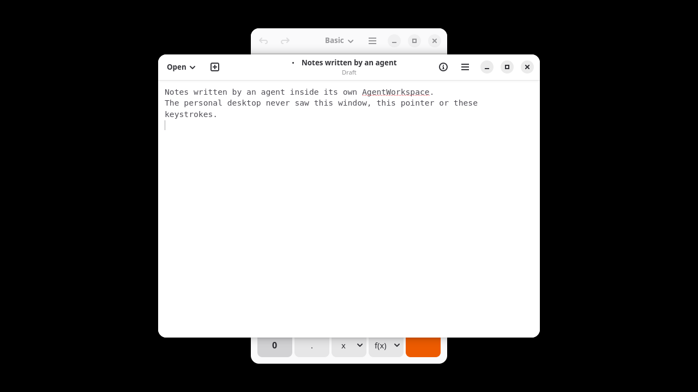

# AgentWorkspaces

Give AI agents their own graphical workspace, so computer use, screenshots and app driving never move your real mouse, steal your focus or touch your windows.

Each workspace is a separate headless Wayland compositor (labwc/wlroots) running on the same kernel and GPU as your desktop. An agent's clicks and keystrokes go only through that compositor's own virtual-input protocols. The agent tools have no code path to your personal session.



* Target: Ubuntu GNOME on Wayland (developed and tested on Ubuntu 26.04, GNOME Shell 50, an NVIDIA GPU).
* Not a security sandbox. Graphical isolation is not filesystem or network isolation. Read [docs/security-model.md](docs/security-model.md).
* Status: early (0.1). What is tested and what is not is listed in [docs/testing.md](docs/testing.md) and [docs/limitations.md](docs/limitations.md).

## What you get

| | |
|---|---|
| `agent-workspaces` CLI + daemon | create, rename, assign to an agent, list, launch apps, screenshot, windows, click/move/type/key/scroll, display info, window actions, pause/resume agent input, enter, destroy |
| MCP server (stdio) | screenshot, windows, launch app, mouse, keyboard, scroll, window actions, display info, status. Bound to the workspace assigned to the calling agent |
| Viewer window | one GTK4 window for all workspaces: sidebar, live overview, Agent / Paused / You control ("You" forwards your mouse and keyboard), approvals and grants, create / stop / close. No GNOME extension needed ([docs/viewer.md](docs/viewer.md)) |
| Optional GNOME extension | Ctrl+Alt+Down enters the AgentWorkspaces workspace, Ctrl+Alt+Up returns. Separate, opt-in, restores your previous shortcuts. See [gnome-extension/](gnome-extension/README.md) |
| Local API v1 | JSON lines over a unix socket, with events. Spec: [docs/api.md](docs/api.md) |
| Per-agent integration | Claude Code, Codex, Antigravity, Hermes Agent, each opt-in and reversible: [docs/integrations.md](docs/integrations.md) |

## Install (user level, no root, nothing in GNOME changes)

```bash
sudo apt install labwc          # the only package that needs root, if you do not have it yet
./install.sh                    # copies to ~/.local/share/agent-workspaces, links ~/.local/bin/agent-workspaces
agent-workspaces create --name research --agent claude-code
agent-workspaces launch research -- gnome-text-editor
agent-workspaces screenshot research -o research.png
agent-workspaces enter research
```

Remove everything with `./uninstall.sh` (`--stop-workspaces`, `--remove-integrations` are available). Requirements: labwc, python3, systemd user session, libxkbcommon, and python3-gi with GTK4 for the viewer.

## How it works in one paragraph

`agent-workspaces create` starts a headless labwc with a private `XDG_RUNTIME_DIR`, a private session bus and a private `HOME`, inside its own systemd slice. The daemon talks to it with a small stdlib-only Python Wayland client: wlr-screencopy for screenshots, wlr-virtual-pointer and virtual-keyboard for input, wlr-foreign-toplevel for windows, wlr-data-control for the workspace's own clipboard, wlr-output-management for resolution and scale. Apps are launched with an environment built from scratch that points only at that compositor. Details and measurements: [docs/architecture.md](docs/architecture.md), [docs/isolation-model.md](docs/isolation-model.md), [docs/measurements.md](docs/measurements.md).

## Documentation

[architecture](docs/architecture.md) · [isolation model](docs/isolation-model.md) · [security model](docs/security-model.md) · [API](docs/api.md) · [agent integrations](docs/integrations.md) · [viewer](docs/viewer.md) · [GNOME extension](docs/gnome-extension.md) · [measurements](docs/measurements.md) · [testing](docs/testing.md) · [troubleshooting](docs/troubleshooting.md) · [limitations](docs/limitations.md)

## License

MIT.
