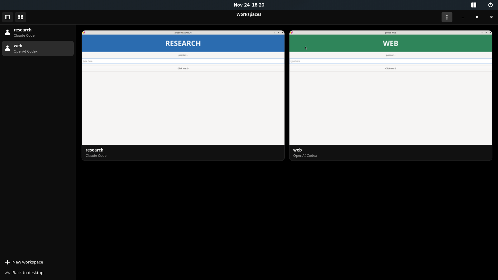

# The viewer

`python3 -m aw.viewer [NAME] [--takeover] [--maximized]` (or `agent-workspaces enter NAME`, or Ctrl+Alt+Down with the
GNOME extension) opens one window for all workspaces. A second call reuses the open window. It is a plain GTK4 client
of your desktop; it needs no extension and uses the daemon API with the admin credential (docs/api.md).

## What is on screen

* **Sidebar**: one row per workspace with its agent (label and icon hint from the API), what the agent is doing
  ("Claude Code · typing" for five seconds after its last input), who has input ("paused", "you are in control") and the
  number of requests waiting for you. The button at the top left collapses it to an icon rail. "New workspace" and, when
  the GNOME extension is present, "Back to desktop" sit at the bottom.
* **Overview** (grid button, top left): every workspace as a live thumbnail, refreshed every 1.5 s only while this view is
  visible. Click one to open it.
* **Workspace view**: the live screen. The header names the workspace and says what happened last, from the daemon's own
  activity record ("Claude Code clicked 3 s ago").
* **Agent | Paused | You**: one setting, who has input. *Paused* rejects the agent's input (`E_PAUSED`) and you only watch.
  *You* rejects it too and forwards your mouse and keyboard; a white frame marks it. *Agent* gives control back and a
  waiting agent continues. Keys and buttons held when you leave *You* or lose focus are released inside the workspace.
* **Request bar** above the workspace: approvals (`approval.request`) with Deny / Approve, and human-only grants
  (`grant.request`: `browser_profile`, `host_clipboard`) with Deny / "Allow for 15 minutes". Grants are accepted by the
  daemon from the viewer because it is a human channel. To show another kind of request, register a renderer:
  `register_approval_view(kind, fn)` in `aw/viewer.py`; `fn(viewer, request, workspace_name)` returns a widget and calls
  `viewer.resolve_approval` or `viewer.resolve_grant`.
* **Clipboard** button: the existing per-workspace clipboard policy (off by default).
* **Menu**: fit to window, fullscreen, start / stop / **close** the workspace. Close asks first: its apps quit and its
  private files are deleted. Closing the *window* is different: it only detaches, every workspace keeps running (a
  workspace left in Paused or You stays paused until someone chooses Agent; the sidebar shows it).
* **New workspace**: name, agent, screen size. The name is validated before the daemon is asked.

Remembered between runs (`~/.config/agent-workspaces/viewer.json`): last workspace, sidebar state, fit.

## Cost

* An idle workspace costs the viewer about 0 % CPU (damage-driven screencopy).
* Frames are capped at 30 per second while you only watch, uncapped while you control (input latency).
* While GNOME marks the window suspended (another GNOME workspace, minimised) the viewer stops capturing and painting
  completely; the workspace is unaffected. Measured numbers: [measurements.md](measurements.md).
* Detaching never touches a workspace: the daemon only counts viewers per connection.

Screenshots of every state, taken in the isolated headless GNOME Shell: `gnome-extension/media/viewer-*.png`
(entered, overview, collapsed, takeover, paused, approval, grant, create, menu, close dialog, stopped).
